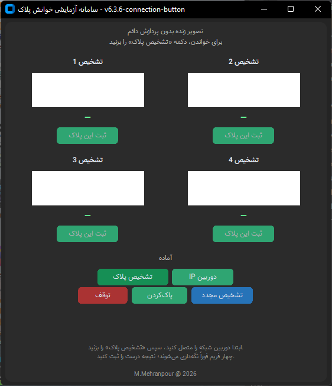
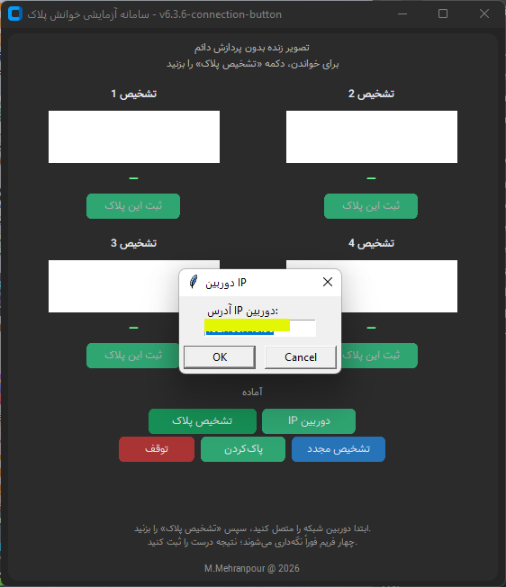
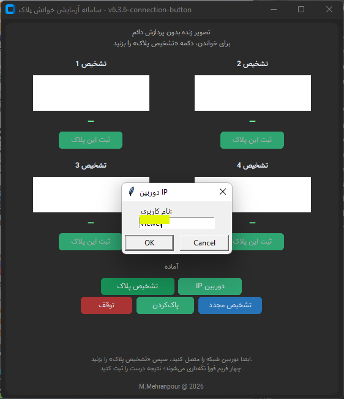
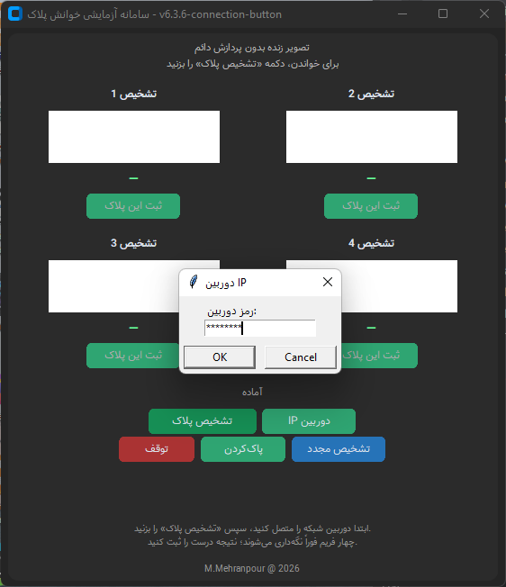
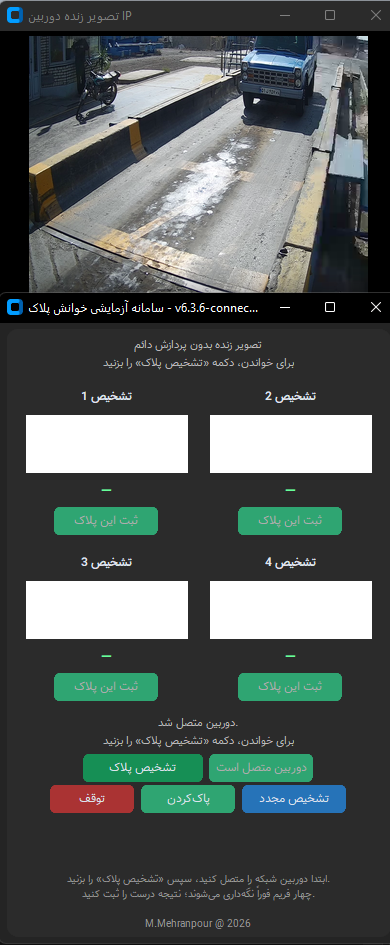
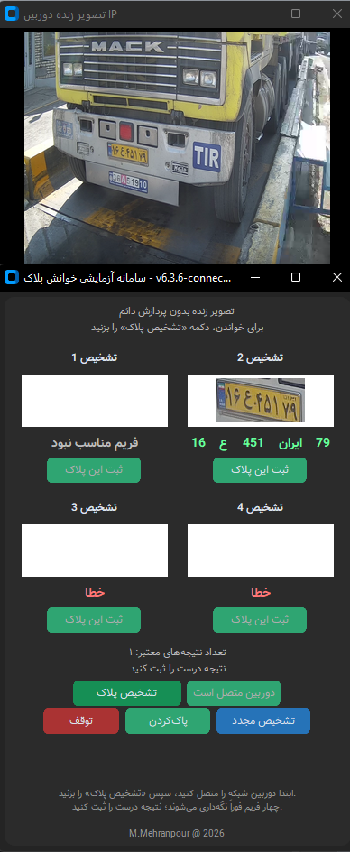
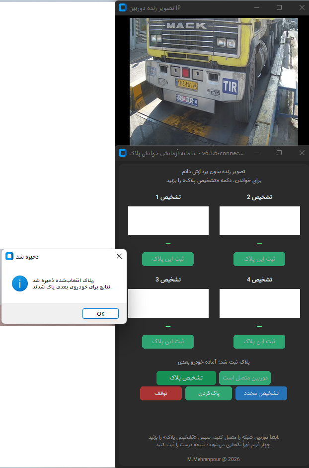
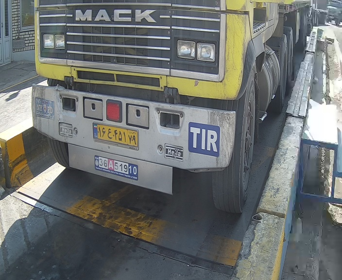

[فارسی](README.fa.md) | [English](README.md)

# مرحلهٔ ۱ — پلاک‌خوان محلی v6.3.6

این نسخهٔ آزمایشی، تصویر زندهٔ دوربین IP را دریافت می‌کرد و با درخواست اپراتور چهار فریم را برای تشخیص پلاک پردازش می‌کرد. اتصال دیتابیس نداشت.

## روند کار

۱. اپراتور دکمهٔ دوربین IP را می‌زد و IP، نام کاربری و رمز را وارد می‌کرد.

۲. پس از اتصال و نمایش تصویر زنده، دکمهٔ تشخیص پلاک را می‌زد.

۳. چهار فریم از بافر اخیر دوربین کپی و پردازش می‌شد؛ هر چهار فریم الزاماً نتیجهٔ معتبر نداشتند.

۴. اپراتور نتیجهٔ صحیح را انتخاب و ذخیره می‌کرد؛ سپس نتایج برای خودروی بعدی پاک می‌شدند.

## امکانات و محدودیت‌ها

- تشخیص مجدد، پاک‌کردن نتایج و توقف دوربین برای قطع و اتصال دوباره.
- ذخیرهٔ پلاک در TXT و CSV، تصویر خودرو و برش پلاک و فایل لاگ محلی.
- بدون اتصال SQL Server و بدون فرم ورود دستی شمارهٔ پلاک.
- خوانش در این مرحله خطا داشت؛ عکس‌ها نمونهٔ واقعی عملکرد هستند، نه ادعای دقت کامل.

## کد منتخب

فایل‌های پوشهٔ `src` گزیده‌هایی از کد واقعی اتصال دوربین، پردازش چهار فریم، نمایش و انتخاب نتیجه، ذخیرهٔ محلی و رمزگشایی خروجی OCR هستند. بخش‌های حذف‌شده مشخص شده‌اند؛ این مجموعه برنامهٔ کامل قابل اجرا نیست. مدل‌ها، اطلاعات اتصال و تنظیمات محیط عملیاتی منتشر نشده‌اند.

## تصاویر به ترتیب اجرا

### 1. صفحهٔ اولیه با چهار جایگاه نتیجه

### 2. اتصال دستی دوربین؛ IP در عکس ارسالی پوشانده شده است

### 2.1. ورود نام کاربری دوربین

### 2.2. ورود رمز دوربین؛ کاراکترها به‌صورت ستاره نمایش داده می‌شوند

### 3. نمای زندهٔ دوربین پیش از تشخیص

### 4. نتایج تشخیص؛ یک نتیجهٔ خوانده‌شده و سایر فریم‌های ناموفق

### 5. پیام ذخیرهٔ محلی و پاک‌شدن نتایج برای خودروی بعدی

## نمونهٔ خروجی ذخیره‌شده و لاگ اجرا

آرشیو ارسالی یک رکورد ذخیره‌شده در تاریخ ۲۰۲۶/۱۰/۲۷ ساعت ۱۲:۴۵:۰۷ با منبع `ip_camera` دارد. نتیجهٔ TXT و CSV برابر `16ع45179` است. تصویر اصلی خودرو و برش پلاک برای مقایسه قرار گرفته‌اند؛ این مقدار خروجی OCR است و به معنی تأیید مستقل صحت خوانش یا سنجش دقت نیست.

| فایل | محتوای نمونه |
|---|---|
| [plates.csv](sample-output/outputs/plates.csv) | یک رکورد ساختاریافته شامل زمان، پلاک کامل، اجزای پلاک، وضعیت پلاک خاص و منبع تصویر |
| [plates.txt](sample-output/outputs/plates.txt) | متن خوانای همان رکورد ذخیره‌شده |
| [passage_app.log](sample-output/logs/passage_app.log) | فقط یک رویداد شروع برنامه با نسخهٔ 6.3.6؛ این لاگ ارسالی رویداد موفقیت ذخیره ندارد |

فایل [requirements.txt](requirements.txt) وابستگی‌های اعلام‌شده در بستهٔ اصلی را نگه می‌دارد؛ در بررسی مستندات، نصب وابستگی‌ها یا تست اجرایی انجام نشده است.

### نتیجهٔ بررسی آرشیو

هر هفت عکس شماره‌دار در ترتیب نمایش مستندات پوشش داده شده‌اند؛ دو عکس نام کاربری و رمز که قبلاً اضافه شدند، دقیقاً همان عکس‌های ۳ و ۴ آرشیو هستند. فایل قدیمی `README_FA.txt` دربارهٔ روند نسخهٔ v5.1 است و راهنمای عملکرد v6.3.6 محسوب نمی‌شود. طبق تصمیم پروژه، فقط گزیده‌های کد پایتون منتشر شده‌اند.

برای نمایش تصویر اصلی روی عکس کلیک کنید.

[بازگشت به مراحل دسکتاپ](../README.fa.md)

