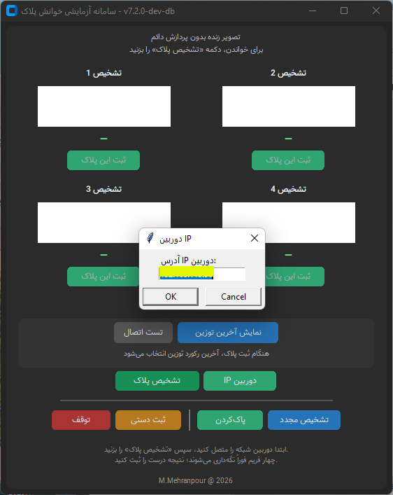
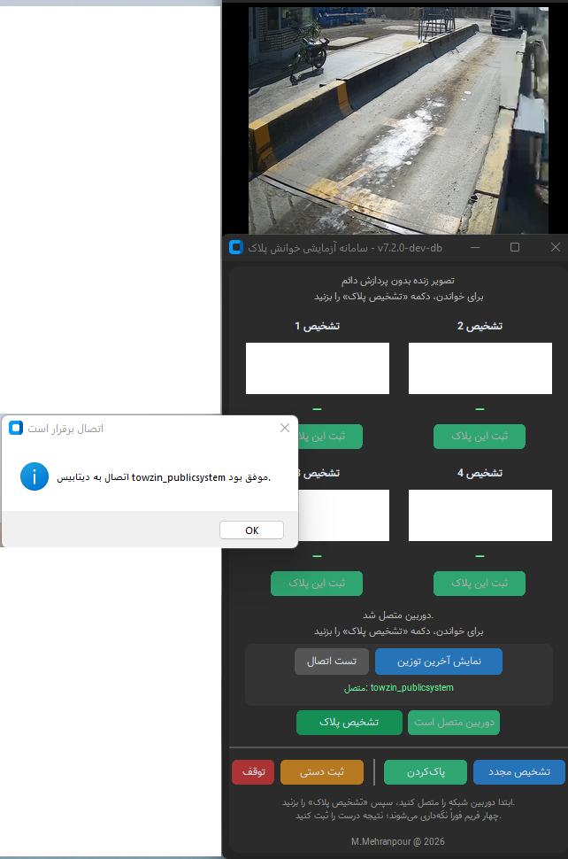
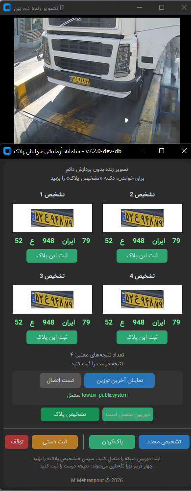
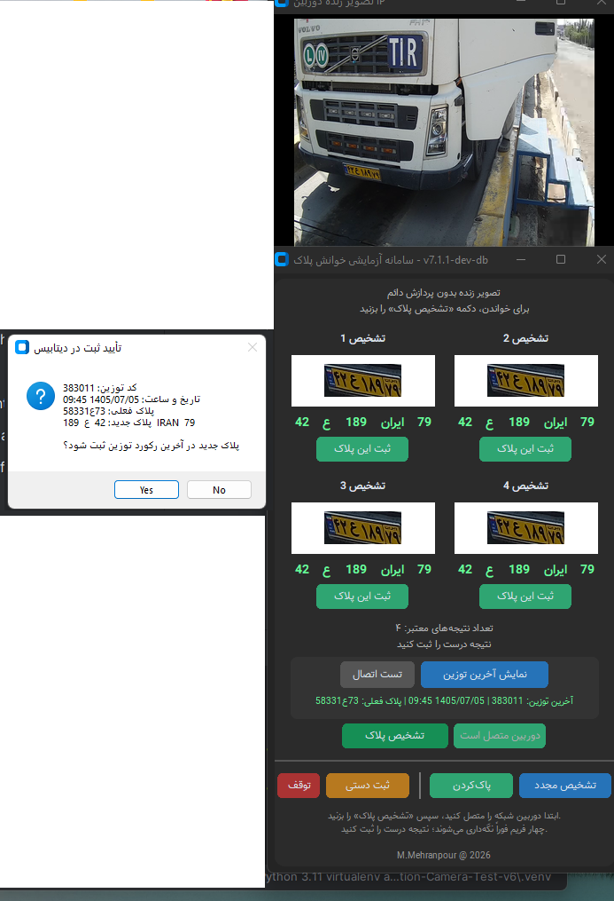
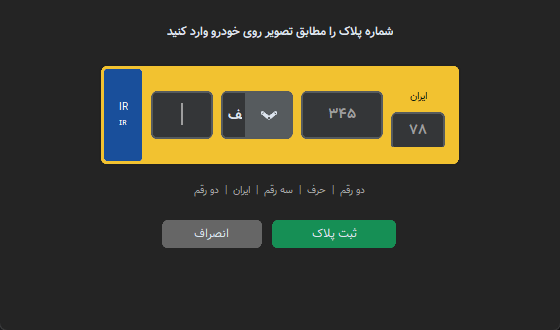
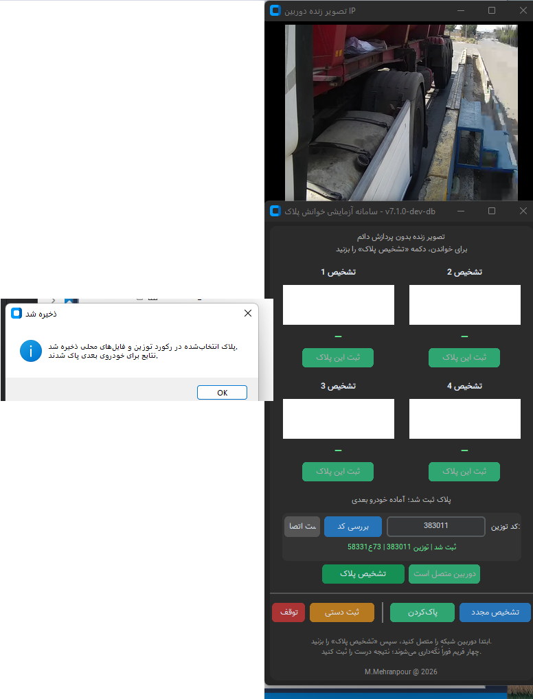
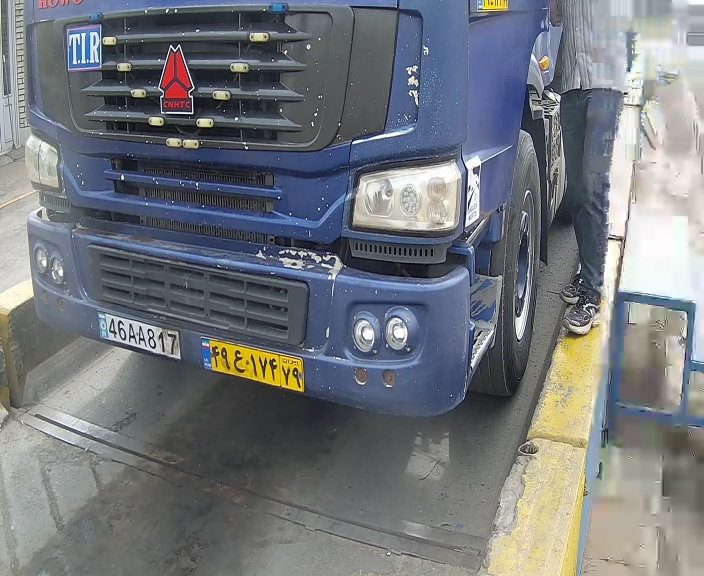

[فارسی](README.fa.md) | [English](README.md)

# مرحلهٔ ۲ — اتصال دیتابیس و رابط چهارفریمی v7.2.0

این مرحله مسیر اتصال پلاک‌خوان به SQL Server و اصلاح روش ثبت پلاک را مستند می‌کند. آزمایش اولیه با دیتابیس ساخته‌شده توسط توسعه‌دهنده موفق بود؛ سپس اتصال به دیتابیس اصلی برنامهٔ توزین انجام شد. این ترتیب بر اساس توضیح توسعه‌دهنده است؛ برای دیتابیس آزمایشی تصویر مستقل در این بسته مشخص نشده است.

## تغییر روش ثبت در نسخه‌های ۷ به بعد

| گام | رفتار | نتیجه |
|---|---|---|
| ثبت اولیه | درج نتیجه در جدول لاگ اختصاصی | شروع اتصال دیتابیس |
| آزمایش روی دیتابیس اصلی | دریافت آخرین کد توزین و Update پلاک همان رکورد | ارتباط با خودروی جاری قابل اتکا نبود و این روش کنار گذاشته شد |
| روش اصلاح‌شده | درج در `plate_reader_log` و `plate_detection` | جدول توزین مستقیماً تغییر نمی‌کرد |

شمارهٔ فرعی دقیق تمام این تغییرات قطعی نیست؛ آن‌ها به‌عنوان مسیر توسعهٔ خانوادهٔ ۷ ثبت شده‌اند.

### چرا آخرین رکورد توزین مناسب نبود؟

پلاک پیش از توزین خوانده می‌شد و آخرین رکورد موجود الزاماً متعلق به خودروی جلوی دوربین نبود. توزین اول رکورد ایجاد می‌کرد و توزین دوم همان رکورد را تکمیل می‌کرد:

| مراجعه | توزین اول | توزین دوم |
|---|---|---|
| دریافت بار | خالی | پر، پس از بارگیری |
| تحویل بار | پر | خالی، پس از تخلیه |

پس ترتیب پر و خالی ثابت نبود و «آخرین کد + ۱» نیز راهکار مستند این پروژه نیست. در روش اصلاح‌شده پلاک‌خوان نتیجه را در جدول تشخیص درج می‌کرد. اتصال آن به تراکنش توزین قرار بود توسط مدیر در سمت دیتابیس انجام شود؛ اجرای تریگر یا پردازش دوره‌ای در این بسته تأیید نشده است. خود برنامهٔ توزین هم امکان ورود دستی پلاک داشت.

## روند اپراتور در رابط v7.2.0

۱. ورود دستی IP و اتصال دوربین؛ در این فایل اطلاعات ورود دوربین از تنظیمات محلی خوانده می‌شود.

۲. تست اتصال دیتابیس و دریافت آخرین رکورد و کد توزین.

۳. درخواست تشخیص، نمایش چهار نتیجه و انتخاب نتیجهٔ صحیح توسط اپراتور.

۴. ثبت نتیجه یا استفاده از فرم ورود دستی پلاک؛ تشخیص مجدد، پاک‌کردن و توقف/اتصال دوباره نیز در دسترس بود.

لاگ و خروجی محلی در کنار ثبت دیتابیس حفظ شدند. پیام تأیید قدیمی رابط هنوز دربارهٔ آخرین رکورد توزین صحبت می‌کند؛ رفتار واقعی نوشتن به فایل سرویس دیتابیس همراه بستگی دارد.

## کدهای منتخب و تطابق فایل‌ها

| فایل | نقش |
|---|---|
| `operator_database_checks_excerpt.py` | تست اتصال، آخرین توزین و پیام تأیید تاریخی |
| `four_frame_selection_excerpt.py` | چهار فریم، انتخاب اپراتور و مسیر ثبت دستی |
| `latest_weighing_read_excerpt.py` | خواندن آخرین رکورد بدون تغییر آن |
| `historical_latest_row_update_excerpt.py` | نمونهٔ تاریخی و کنارگذاشته‌شدهٔ Update؛ از پوشهٔ `old vesion` |
| `detection_and_audit_insert_excerpt.py` | روش اصلاح‌شدهٔ درج در دو جدول لاگ و تشخیص |

این فایل‌ها گزیده‌های واقعی‌اند؛ برنامهٔ کامل قابل اجرا نیستند و وابستگی‌ها و بخش‌های حذف‌شده در توضیح فایل‌ها مشخص شده‌اند. نام قدیمی `save_plate_to_latest` در سرویس اصلاح‌شده باقی مانده، ولی آن متد جدول توزین را Update نمی‌کند. متد تاریخی علاوه بر Update توزین، منطق درج خودرو، لاگ و یک جدول کمکی هم دارد؛ آن را الگوی پیشنهادی معرفی نمی‌کنیم.

آرشیو شامل نسخه‌های میانی v7.2.1، v7.2.2 و v7.3.0 نیز هست؛ رابط‌های بعدی در این مرحله منتشر نشده‌اند. تنظیمات واقعی دیتابیس و دوربین، رمزها و وزن‌های مدل منتشر نمی‌شوند.

## تصاویر به ترتیب کار

### 1. اتصال دستی با ورود IP دوربین

### 2. پیام موفقیت تست اتصال دیتابیس

### 3. چهار نتیجهٔ تشخیص و انتخاب اپراتور

### 4. تأیید تاریخی ثبت در آخرین توزین؛ عنوان پنجره v7.1.1-dev-db است

### 5. فرم ورود دستی شمارهٔ پلاک

## نمونهٔ تنظیمات و ساخت settings

- فایل [camera_config.json](config/camera_config.json) ساختار تنظیمات دوربین را نشان می‌دهد.
- فایل [db_config.json](config/db_config.json) ساختار تنظیمات دیتابیس را نشان می‌دهد.
- رمزها با `********` و آدرس‌ها، نام کاربری و نام دیتابیس با مقادیر نمونه جایگزین شده‌اند. این‌ها تنظیمات عملیاتی قابل استفاده نیستند.
- فایل [Make-Settings.py](src/Make-Settings.py) گزیدهٔ تابع ساخت تنظیمات است: دو JSON محلی را می‌خواند و با `pformat` دیکشنری‌های `CAMERA_CONFIG` و `DATABASE_CONFIG` را داخل `settings.py` می‌نویسد. **این کار هش یا رمزنگاری نیست**؛ اطلاعات در فایل تولیدشده خوانا باقی می‌مانند. importها و نقطهٔ اجرای اسکریپت در گزیده حذف شده‌اند.
- ابزار اصلی دو JSON را کنار اسکریپت محلی می‌خواهد. نمونه‌های عمومی اینجا برای نظم در پوشهٔ `config/` قرار دارند؛ برای بازسازی ترتیب ساخت باید محلی کپی و تنظیم شوند. نمونه‌های ستاره‌دار برای تولید تنظیمات واقعی نیستند.
- فایل تولیدشدهٔ `settings.py` خصوصی می‌ماند و در `.gitignore` این مرحله آمده است.

### نقش فایل سرویس دیتابیس

فایل ارسالی `database_service.py` مسئول اتصال SQL، پرس‌وجو، ثبت و تراکنش‌هاست. طبق تصمیم پروژه کامل منتشر نشده است. گزیده‌های [خواندن توزین](src/latest_weighing_read_excerpt.py)، [Update تاریخی](src/historical_latest_row_update_excerpt.py) و [درج اصلاح‌شده در لاگ و تشخیص](src/detection_and_audit_insert_excerpt.py) جدا هستند تا دو روش ثبت با هم اشتباه نشوند.

### بازبینی تصاویر

برای ورود IP، همان عکس پوشانده‌شدهٔ قبلی حفظ شد؛ عکس جدید IP داخلی را آشکار نشان می‌دهد. تست اتصال، چهار نتیجه، تأیید تاریخی آخرین توزین و فرم ثبت دستی بالاتر آمده‌اند. عکس تاریخی زیر هم اضافه شده است: عنوان پنجره `v7.1.0-dev-db` و پیام ذخیره دارد؛ آن را عکس v7.2.0 معرفی نمی‌کنیم.

عکس تک‌نتیجه با دکمهٔ ثبت جدا مربوط به v7.2.2 است. عکس تشخیص و ثبت یکجا مربوط به v7.3.0 است و خطای ذخیره با امکان تلاش دوباره را نشان می‌دهد. این عکس‌ها و تصویر شروع اتصال خودکار برای مرحلهٔ سوم هستند و به‌عنوان عملکرد v7.2.0 معرفی نشده‌اند.

## نمونه‌های لاگ و خروجی این دوره

این پوشهٔ خروجی بین چند نسخه مشترک بوده است. CSV و TXT شامل هشت رکورد ذخیره‌شده‌اند؛ زمان آن‌ها در لاگ با اجرای v7.2.2 همراه است و خروجی قطعی رابط v7.2.0 معرفی نمی‌شوند. نام تصویرها کد توزین دارد، اما این نام‌گذاری یا متن «saved in SQL Server» به‌تنهایی ثابت نمی‌کند جدول توزین Update شده است.

- [CSV](sample-output/outputs/plates.csv) و [TXT](sample-output/outputs/plates.txt): هشت رکورد ارسالی.
- [گزیدهٔ لاگ](sample-output/logs/passage_app.selected.log): فقط خطوط اصلی شروع نسخه‌ها و موفقیت ثبت، با متن اصلی؛ خطاها و Stack Traceهای محیطی حذف شده‌اند. این فایل لاگ کامل نیست.
- [وابستگی‌های ارسالی](requirements.txt): فهرست اصلی بسته؛ نصب و تست اجرایی انجام نشده است.

عکس‌های خروجی برای مقایسه با OCR حفظ شده‌اند و سنجش مستقل دقت نیستند. برای اندازهٔ اصلی روی عکس کلیک کنید.

[بازگشت به مراحل دسکتاپ](../README.fa.md)

