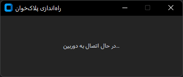
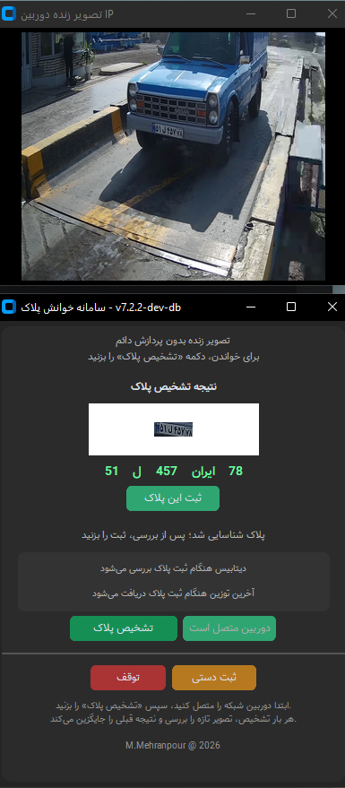
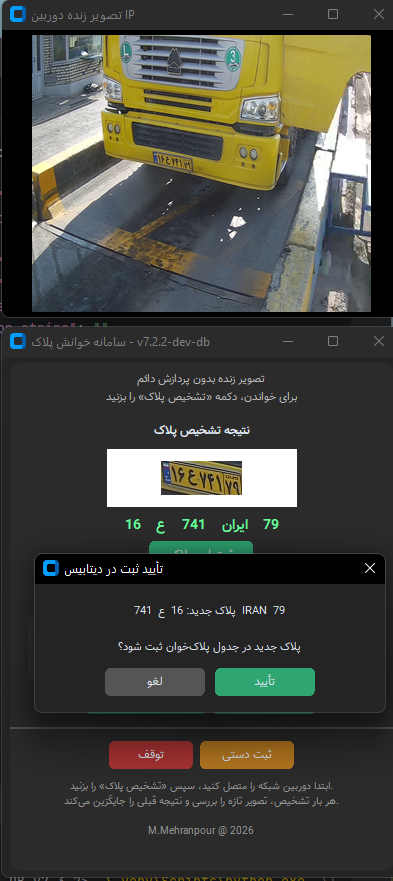
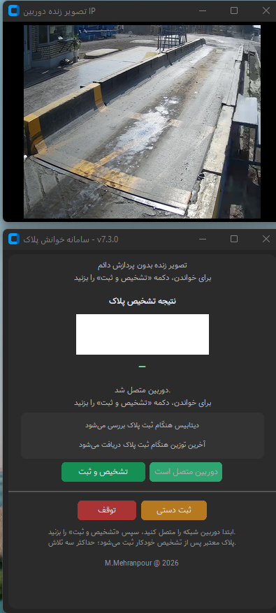
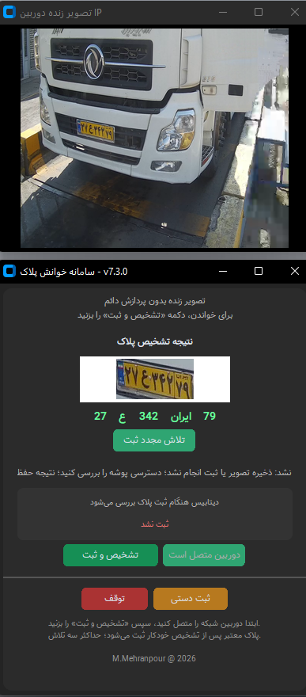
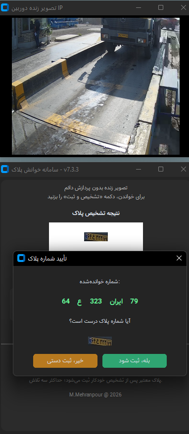
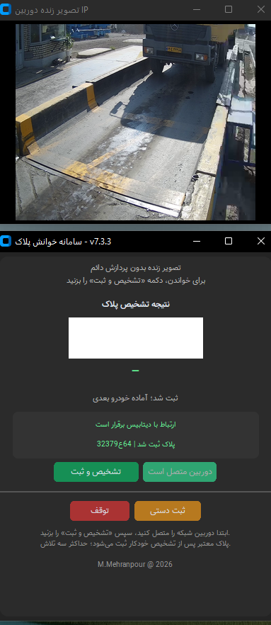
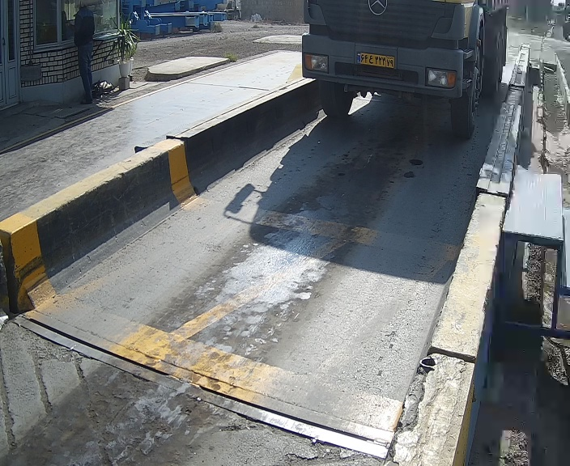
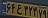
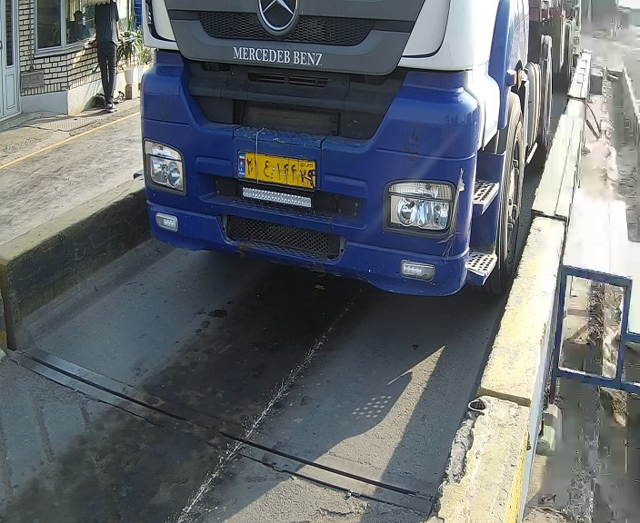

[فارسی](README.fa.md) | [English](README.md)

# Stage 3 — v7.3.x Automatic Connection and Single-Result Workflow

This stage covers the transition from four candidates to one displayed result, streamlined registration and manual fallback. v7.2.2 is the intermediate step. Although the archive is named v7.3.2, it also contains v7.3.3 code, the final two screenshots and runtime logs. Evidence is labeled by its actual version.

## Version changes

| Version | Main change |
|---|---|
| v7.2.2 | Automatic configured connection; no IP-entry, connection-test or latest-weighing buttons in the main UI; separate recognition and registration |
| v7.3.0 | Combined recognition/registration action; up to three fresh-frame attempts; first valid result enters registration |
| v7.3.2 | Automatically opens manual entry after three failed attempts; stopping/closing does not open that fallback |
| v7.3.3 | Compares OCR with the plate crop before saving; rejection opens manual correction with recognized parts prefilled; failed-frame diagnostics |

Single-result means one displayed result, not necessarily one processed frame. The reviewed path accepts the first valid result, rather than ranking three results for a best frame. Valid plate formatting does not establish OCR correctness; v7.3.3 adds operator confirmation.

## Connection, messages and registration

- The camera connects automatically using local settings. Database status is checked along the registration path, without a separate test button in the streamlined UI.
- Earlier detached messages evolved into centered modal dialogs and more inline status messages. Not all dialogs were removed: v7.3.3 still explicitly confirms the recognized plate.
- Camera stop/restart and manual entry remain available.
- A save failure retains the result and allows a registration retry; recognition retries are distinct from blindly repeating database writes.
- The supplied service reads latest-weighing context and inserts into `plate_reader_log` and `plate_detection`; it does not update `towzin_tb`. Its historical `save_plate_to_latest` name remains.

## Selected code and configuration

`src` separates excerpts for v7.2.2, v7.3.0, v7.3.2 and v7.3.3, plus the database insert method. Imports, UI initialization and other application sections are omitted. These are not complete executable releases.

[Camera](config/camera_config.json) and [database](config/db_config.json) examples replace passwords with `********` and connection identities with placeholders. Production settings and `settings.py` are excluded. The [previous stage's settings helper](../02-v7.2.0-Database-Integration/src/Make-Settings.py) copies JSON to Python dictionaries; it does not hash or encrypt passwords. The v7.3.2 guide says regenerating settings was unnecessary for that patch.

## Ordered screenshots

### 1. Automatic camera startup

### 2. v7.2.2 — separate recognition and registration

### 3. v7.2.2 — confirmation over the control window

### 4. v7.3.0 — combined recognition and registration

### 5. v7.3.0 — save failure, retained result and retry

### 6. v7.3.3 — compare OCR and crop before registration

### 7. v7.3.3 — registration complete, ready for next vehicle

## Logs and saved output

The [supplied log](sample-output/logs/passage_app.log) identifies v7.3.3 sessions: SQL/output saves, three OCR-incomplete diagnostic frames and a `manual_entry` registration. [CSV](sample-output/outputs/plates.csv) and [TXT](sample-output/outputs/plates.txt) are the supplied files; their coverage need not match every log event. A weighing code in a filename or log message does not establish an update to the weighing table.

A saved vehicle, plate crop and failed-frame sample follow for output comparison, not independent accuracy measurement.

## Material kept separate from the main workflow

`improve frame` contains quality, crop and HD experiments. The primary guide explicitly says `plate_quality.py` and `hd_capture.py` are unused in the v7.3.2 combination, and that patch does not add OCR accuracy improvements or Primary FullHD. Local test settings, old guides and experimental packages are not presented as main-release features.

[Dependencies](requirements.txt) are preserved from the package. Review covers version attribution, documentation and excerpt syntax, not execution of the application or models. Click images to open their original size.

[Back to desktop stages](../README.md)
