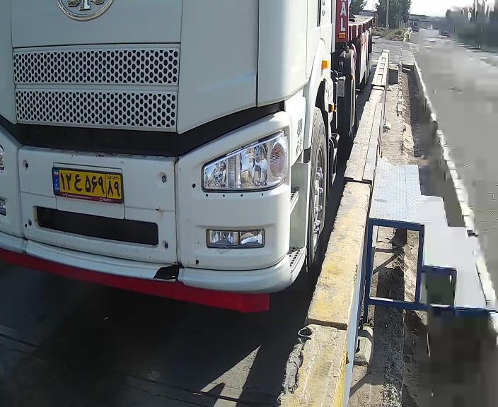

[فارسی](README.fa.md) | [English](README.md)

# Web Pilot 1.0.0

This version brought the desktop four-candidate workflow to a browser: live camera, operator-requested processing of four frames, review, and saving the selected result. Web version numbers are independent; this is not the later single-result desktop workflow.

Source is taken from the nested `PlateReader-Web-Pilot-v1.0.0` folder. The root app in the archive named 1.0.0 actually identifies itself as 1.0.3. Detection runs within the request handler.

## Workflow and integration

1. Run the local web host and open the narrow browser panel beside the weighing application.
2. Connect the configured camera, test SQL connectivity and retrieve the latest weighing using the UI controls.
3. Request detection, compare four candidates and press the selected candidate's registration button.
4. Use manual plate entry, retry, clear, stop or reconnect when needed.

The supplied code reads camera credentials from JSON and starts the camera automatically. It does not establish that all database controls were removed or SQL connectivity was always automatic. The developer-reported earlier manual credential stage is not assigned an unsupported version number.

The supplied database service reads the latest weighing, inserts a vehicle when needed, updates that weighing row's plate and appends an audit record transactionally. This is the historical latest-row strategy, not the final desktop detection-only integration. See the [desktop explanation of its limitations](../../01-PlateRecognition-Desktop/02-v7.2.0-Database-Integration/).

## Published source and configuration

`src/` contains actual Python, HTML, JavaScript and CSS excerpts only. Complete application initialization, remaining source and models are excluded; this is not independently runnable. [Camera](config/camera_config.json) and [database](config/db_config.json) JSON are placeholders with `********` passwords. [Web dependencies](requirements-web.txt) are preserved from the package, without installation or runtime testing.

## Screenshots and evidence

No supplied screenshot is verified as 1.0.0; 1.0.3 screenshots are not relabeled as this version. See the [shared gallery](../README.md), with compact previews linked to original files.

[CSV](sample-output/outputs/plates.csv), [TXT](sample-output/outputs/plates.txt) and [selected log](sample-output/logs/web_app.selected.log) come from this archive's accompanying evidence folder. Mixed archive contents mean the ZIP name alone does not prove which app version produced each record. The log contains selected informational lines, not the complete runtime log. OCR output is not independently verified accuracy evidence.

The pilot was built and tested locally. A dedicated server was not supplied, so the final organizational web deployment did not proceed and the Windows application remained in use.

[Back to web overview](../README.md)
