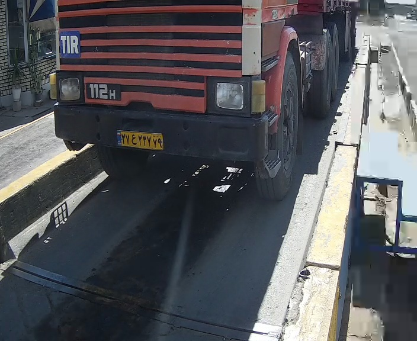
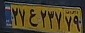
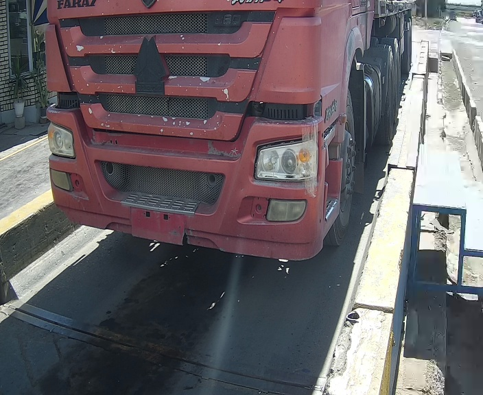

[فارسی](README.fa.md) | [English](README.md)

# نسخهٔ وب 1.0.3

این نسخه روند چهارفریمی دسکتاپ را به مرورگر منتقل کرد: دریافت تصویر زنده، پردازش چهار فریم با درخواست اپراتور، نمایش نتایج و ثبت نتیجهٔ انتخابی. شماره‌گذاری وب مستقل از دسکتاپ است؛ این نسخه ادامهٔ جریان تک‌نتیجه‌ای دسکتاپ نیست.

در این نسخه، پردازش تشخیص به worker منتقل شده و وضعیت و نتایج هنگام پردازش قابل دریافت‌اند. تست اتصال دیتابیس وضعیت واضح‌تری در رابط دارد. فریم‌های نامعتبر نیز برای بررسی ذخیره می‌شوند؛ این رفتار در کد اولیه هم وجود دارد و صرفاً قابلیت تازهٔ 1.0.3 معرفی نمی‌شود.

## روند کار و اتصال

۱. اجرای میزبان محلی وب و بازکردن پنل باریک مرورگر کنار برنامهٔ توزین.

۲. اتصال دوربین از تنظیمات محلی؛ تست اتصال دیتابیس و نمایش آخرین توزین با کنترل‌های رابط.

۳. زدن تشخیص، بررسی چهار نتیجه و زدن «ثبت این پلاک» برای نتیجهٔ درست.

۴. استفاده از ثبت دستی، تشخیص مجدد، پاک‌کردن یا توقف و اتصال دوباره در صورت نیاز.

در کد ارسالی، نام کاربری و رمز دوربین از JSON خوانده می‌شود و دوربین خودکار شروع می‌شود؛ حذف همهٔ کنترل‌های دیتابیس یا اتصال خودکار قطعی آن ادعا نمی‌شود. سابقهٔ ورود دستی اطلاعات که توسعه‌دهنده شرح داده، به شمارهٔ نسخه‌ای بدون شاهد نسبت داده نشده است.

سرویس دیتابیس این بسته شامل خواندن آخرین توزین، درج خودرو در صورت نیاز، Update پلاک رکورد توزین و درج لاگ در تراکنش است. این همان راهکار تاریخی آخرین رکورد است، نه روش نهایی درج فقط در جدول تشخیص دسکتاپ. [علت کنارگذاشتن آن روش](../../01-PlateRecognition-Desktop/02-v7.2.0-Database-Integration/README.fa.md) در بخش دسکتاپ توضیح داده شده است.

## کد و تنظیمات منتشرشده

فقط گزیده‌های واقعی Python، HTML، JavaScript و CSS در `src/` آمده‌اند؛ کل سورس، راه‌اندازی و مدل‌ها حذف شده‌اند و این مجموعه مستقل اجرا نمی‌شود. [تنظیمات دوربین](config/camera_config.json) و [دیتابیس](config/db_config.json) نمونه‌اند و رمزها `********` هستند. [وابستگی‌های وب](requirements-web.txt) از بستهٔ اصلی‌اند؛ نصب و تست اجرایی انجام نشده است.

## تصویر و شواهد

دو تصویر با نسخهٔ خوانای 1.0.3 و دو تصویر با شمارهٔ نسخهٔ نامشخص در گالری مشترک، جدا برچسب خورده‌اند. [گالری مشترک](../README.fa.md) عکس‌ها را با اندازهٔ کوچک و لینک اصل نشان می‌دهد.

[CSV](sample-output/outputs/plates.csv)، [TXT](sample-output/outputs/plates.txt) و [گزیدهٔ لاگ](sample-output/logs/web_app.selected.log) از پوشهٔ همراه آرشیو هستند؛ چون بسته‌ها مخلوط‌اند، نام ZIP به‌تنهایی نسخهٔ تولیدکنندهٔ خروجی را ثابت نمی‌کند. لاگ فقط خطوط اطلاعاتی منتخب دارد و فایل کامل نیست. خروجی OCR سنجش مستقل دقت نیست.

این نسخه ساخته و محلی آزمایش شد، ولی به‌دلیل تهیه‌نشدن سرور، استقرار نهایی سازمانی انجام نشد و نسخهٔ ویندوز در استفاده باقی ماند.

[بازگشت به بخش وب](../README.fa.md)

