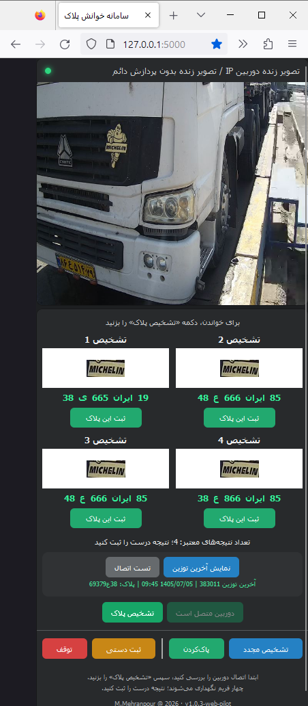
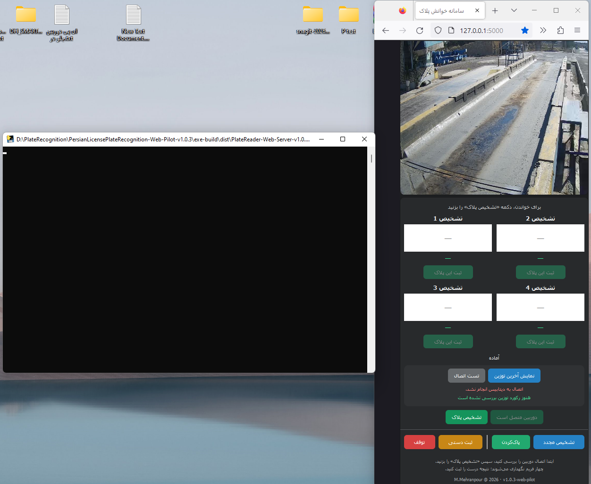
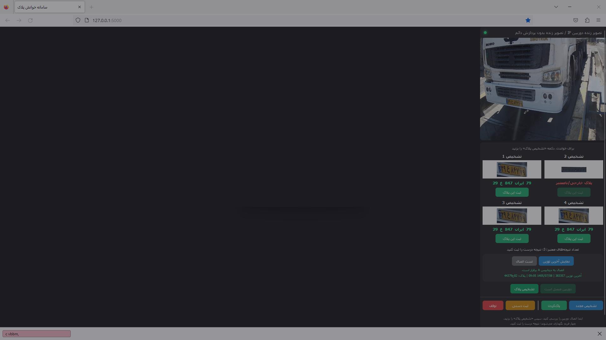
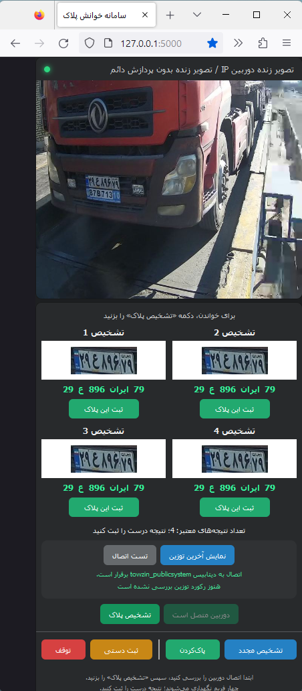

[فارسی](README.fa.md) | [English](README.md)

# 02 — Plate Recognition Web Pilot

The goal was to bring the desktop four-candidate workflow to a narrow browser panel beside the weighing application. Four frames were processed and the operator selected one result for registration. Web versions have independent numbering.

| Version | Documentation |
|---|---|
| v1.0.0 | [Initial pilot](01-v1.0.0-Web-Pilot/) |
| v1.0.3 | [Worker processing and clearer UI feedback](02-v1.0.3-Web-Pilot/) |

## Project status

The web pilot was built and tested locally. The required dedicated server was not supplied, so organizational deployment did not proceed and the Windows application remained in use. Localhost and the packaged EXE web host demonstrate local execution, not organizational server deployment. The supplied captures do not show the weighing application beside the panel; side-by-side use was the design goal.

## Shared screenshot gallery

Images are stored once. Version attribution is made only when identifiable. Compact previews link to original screenshots.

### 1. v1.0.3 — diagnostic example: OCR mistakes a vehicle logo for a plate

### 2. v1.0.3 — local EXE host and browser; database not connected in this capture

### 3. Version unverified — three valid-format results and one invalid result; browser overlay present

### 4. Version unverified — connected database and four displayed results

Only selected code excerpts are published. Credentials, operational settings, model weights and complete source are excluded. Each version documents the difference between its database service and the final desktop integration.
