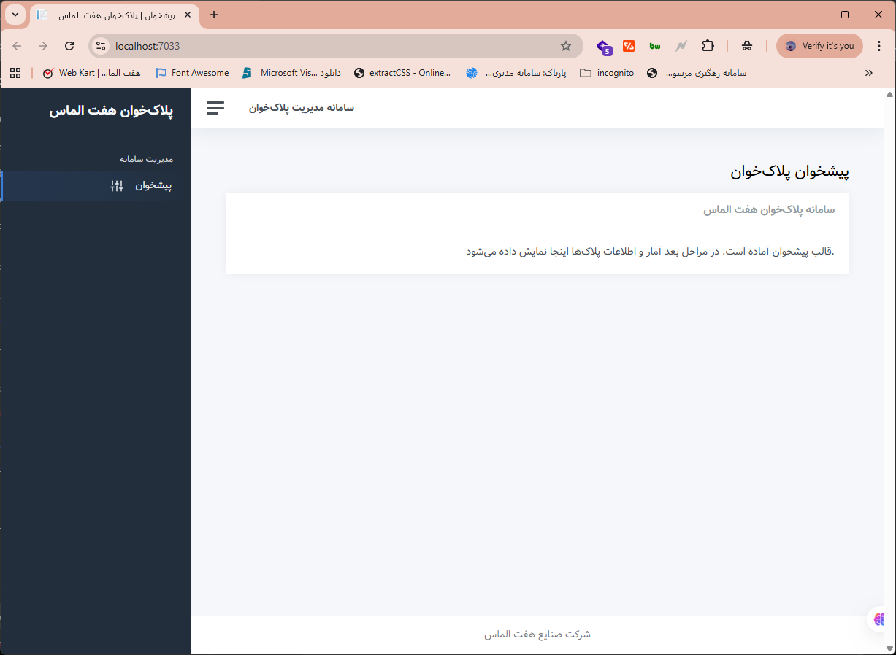
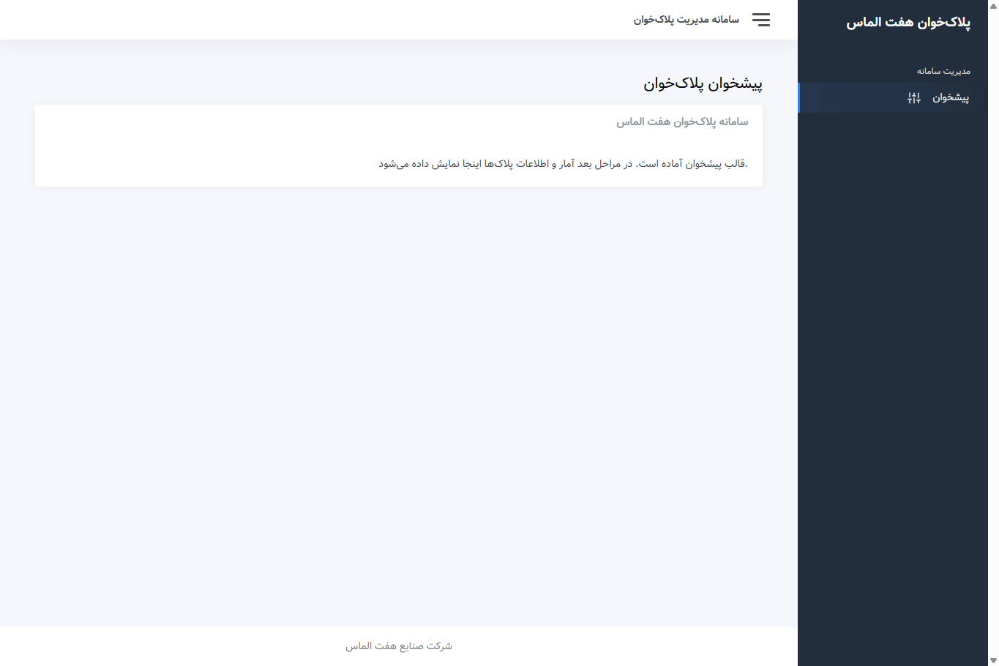
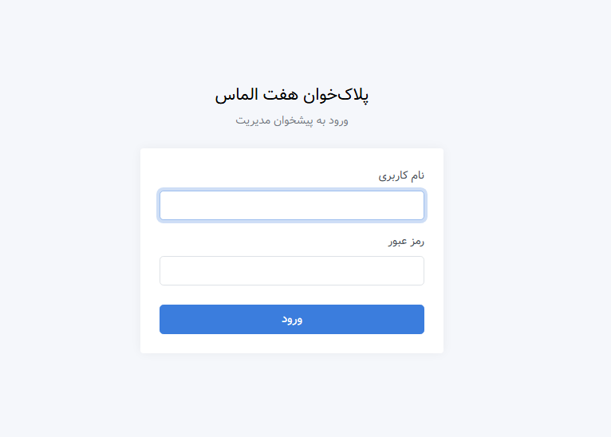
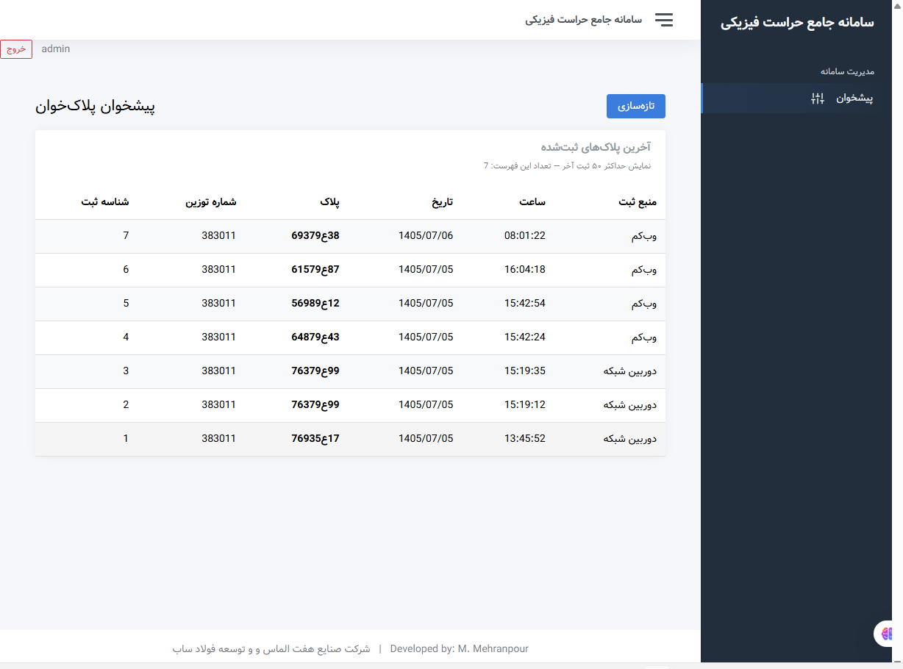
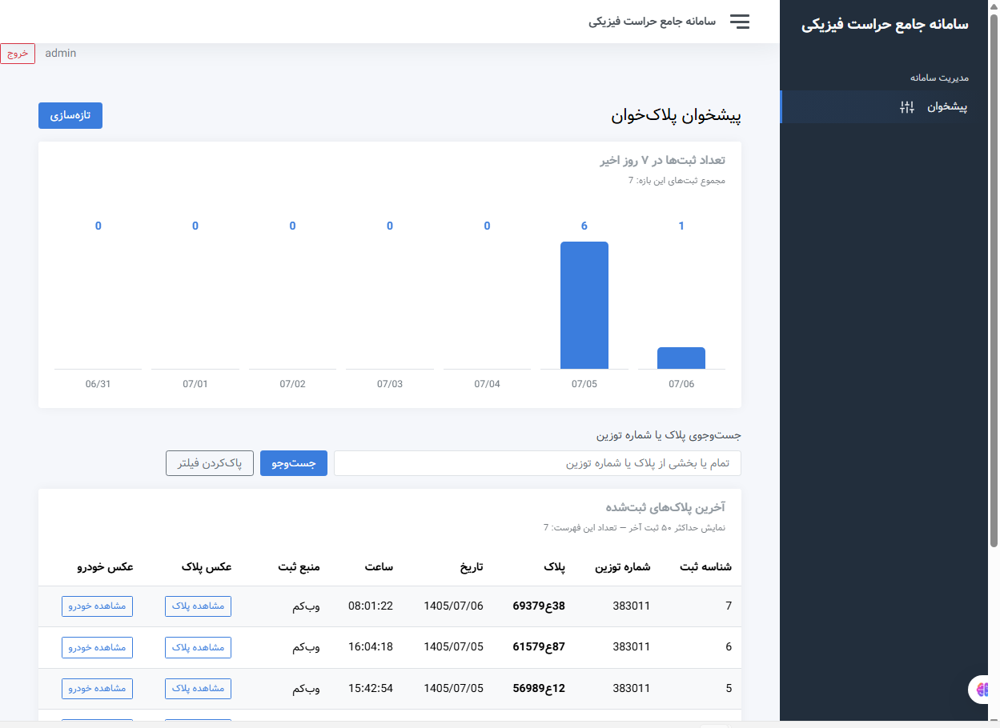

[فارسی](README.fa.md) | [English](README.md)

# 03 — Web Management Dashboard

An ASP.NET Core MVC / .NET 8 dashboard for inspecting plate registrations and weighing information. This is separate from the operational web plate-reader panel: its current role is data retrieval and presentation. A shared management workspace for plate recognition and weighing was the broader development goal.

## Execution and deployment

According to the developer, no dedicated server was supplied. The dashboard host runs on the head of security's workstation and opens through localhost in that workstation's browser, while reading SQL Server data over the network. A local web host does not mean a local database. Browser screenshots demonstrate local execution; the workstation deployment arrangement is developer-reported.

| Component | Execution location or source |
|---|---|
| Browser and dashboard host | Head of security's workstation; localhost |
| Plate and weighing records | Network SQL Server database |
| Vehicle and plate images | Configured image directory, accessible to the dashboard host |

Database access alone does not guarantee image-file access. The image controller retrieves image names from records and serves files from the configured root directory.

## Evolution and implemented behavior

1. Initial shell with a left menu, followed by right-side navigation and collapse behavior appropriate for Persian content.
2. Database-backed plate records; the source also contains a weighing-data retrieval service.
3. Username/password login with hash verification and cookie sessions.
4. Seven-day registration counts, plate/weighing-code search, refresh and links to plate/vehicle images.

Screenshots demonstrate the plate table and chart, but no separate weighing page or opened vehicle-image view is supplied. Complete operational weighing forms or OCR execution inside the dashboard are not claimed.

## Authentication and technology

- ASP.NET Core Identity `PasswordHasher<string>` hashes passwords and `VerifyHashedPassword` verifies them. Unlike the Python settings-generation helper, this is actual password hashing.
- The code includes a `--hash-password` path, cookie sign-in and `[Authorize]` on protected controllers. Login identity comes from configuration; a complete multi-user administration system is not claimed.
- ASP.NET Core MVC, .NET 8, Razor, Dapper and Microsoft.Data.SqlClient; AdminKit layout with custom Persian/right-menu CSS.
- Reviewed plate, chart and weighing queries use SELECT: the dashboard's documented role is retrieval and display.

## Selected source

| Folder | Contents |
|---|---|
| `src/authentication/` | Hash generation, password verification and cookie-setting excerpts |
| `src/data-access/` | Weekly counts, plate search and weighing-query excerpts |
| `src/interface/` | Navigation Razor fragment and right-menu CSS |

Fragments are taken from the actual project. Surrounding classes, imports, initialization and other logic are omitted; this is not a complete buildable project. [Example settings](config/appsettings.example.json) replace passwords and the real password hash with `********`, and connection identities with placeholders. Asterisks are not a valid login hash. Credentials, real hashes, operational settings, executables, DLLs, bin/obj output and bundled third-party libraries are excluded.

## Screenshots in development order

### 1. Initial shell with the menu on the left

### 2. Persian layout with the menu moved to the right

### 3. Username and password login

### 4. Records read from the network database

### 5. Seven-day chart, search and image links

One of the near-duplicate table captures is used. Click any preview for the original image. Review covered source, screenshots, documentation and links; the project was not built or run here and database connectivity was not tested.
