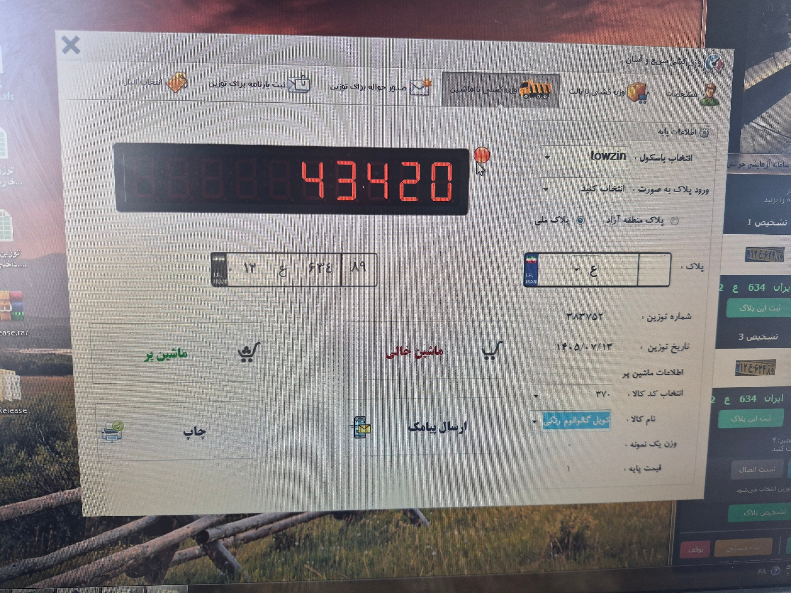
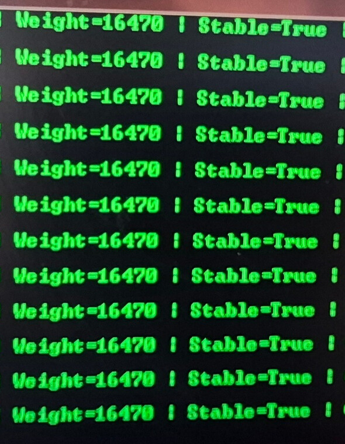
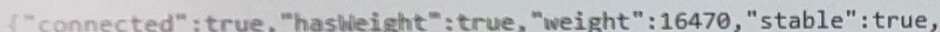

[فارسی](README.fa.md) | [English](README.md)

# ۰۵ — خواندن وزن باسکول و مسیر یکپارچه‌سازی

پس از پلاک‌خوان و پیشخوان مدیریت، توسعه به سمت دریافت وزن باسکول با ابزار و ایجنت ویندوزی پیش رفت. طبق گزارش توسعه‌دهنده، ابتدا ارتباط با دستگاه برقرار شد و سپس وزن در برنامهٔ آزمایشی دریافت و نمایش داده شد. هدف، کنار هم قرار دادن وزن، پلاک‌خوان و اطلاعات توزین در یک جریان کاری مشترک مدیریت و حراست بود.

## مسیر توسعه

| مرحله | نتیجه و وضعیت |
|---|---|
| ارتباط با دستگاه | ابزار اولیه ارتباط را برقرار کرد و داده دریافت کرد |
| خواندن وزن | دریافت و نمایش وزن در تست میدانی، طبق گزارش توسعه‌دهنده |
| یکپارچه‌سازی | قابلیت‌های وزن و پلاک‌خوان به سمت جریان کاری مدیریت توزین پیش رفتند؛ رابط نهایی منتشر نمی‌شود |
| میزبانی متمرکز وب | وابسته به تهیهٔ سرور بود؛ استقرار متمرکز وب به‌عنوان انجام‌شده معرفی نمی‌شود |

ایجنت خواندن وزن با [ایجنت انتقال پلاک به فرم توزین](../04-Weighbridge-Agent-Integration/README.fa.md) متفاوت است. این بخش فقط شرحی کلی از قابلیت‌ها و روند توسعه منتشر می‌کند.

## عکس‌های عمومی

دو عکس نخست، زمینهٔ تست میدانی را نشان می‌دهند. عکس‌های برش‌خوردهٔ بعدی، ابزار آزمایشی خواندن وزنِ توسعه‌دهنده، خروجی ایجنت وزن و پاسخ API محلی را نشان می‌دهند. تنظیمات ارتباط، داده‌های خام و آدرس‌ها با برش حذف شده‌اند. نتایج قابل مشاهده از عکس‌های ارسالی حفظ شده‌اند؛ هیچ تصویر مولد یا بازسازی‌شده‌ای استفاده نشده است. این تصاویر مدرک کالیبراسیون یا تصویر پیشخوان نهایی نیستند.

### ۱. محیط واقعی باسکول

### ۲. برنامهٔ موجود توزین در محیط تست

این تصویر، صفحهٔ برنامهٔ موجود توزین است؛ رابط محصول نهایی یا اثبات مستقل درستی ابزار جدید خواندن وزن نیست. عکس‌ها در زمان‌های متفاوت گرفته شده‌اند و مقایسهٔ هم‌زمان دو اندازه‌گیری وزن محسوب نمی‌شوند. برای مشاهدهٔ تصویر در اندازهٔ اصلی، روی آن کلیک کنید.

### ۳. نمایش ۴۳٬۴۰۰ کیلوگرم در ابزار آزمایشی خواندن وزن

### ۴. گزارش مکرر Weight=16470 و Stable=True در خروجی ایجنت

### ۵. پاسخ API محلی با connected=true، hasWeight=true، weight=16470 و stable=true

این تصاویر، لحظه‌های متفاوت تست را ثبت می‌کنند. تصویر ابزار خواندن وزن با مقدار ۴۳٬۴۰۰ کیلوگرم و تصویر قبلی برنامهٔ موجود با مقدار ۴۳٬۴۲۰، مقایسهٔ هم‌زمان برای سنجش دقت نیستند. عکس‌های ایجنت و API هر دو مقدار ۱۶٬۴۷۰ را در زمان‌های متفاوت نشان می‌دهند. برای مشاهدهٔ نسخهٔ برش‌خوردهٔ منتشرشده، روی تصویر کلیک کنید؛ اصل تصاویر بدون حذف جزئیات در مخزن قرار ندارد.

## مؤلفهٔ تجاری اختصاصی

این مؤلفه به یک محصول تجاری تبدیل شده است. کد دریافت و پردازش وزن، از جمله ایجنت آن، اختصاصی است و در این مخزن منتشر نمی‌شود. حق نشر © ۲۰۲۶ ملیکا مهران‌پور. تمامی حقوق محفوظ است.

کد ارتباط و دریافت وزن، الگوریتم‌های پردازش، جزئیات پروتکل، داده‌های خام دستگاه، تنظیمات اجرایی، فایل‌های ساخت، فایل‌های باینری و تصویر پیشخوان نهایی یکپارچه منتشر نمی‌شوند. کد فرم و آرشیو WeighbridgeSystem نیز منتشر نشده‌اند. مستندات عمومی، پیاده‌سازی اختصاصی دریافت وزن را در اختیار قرار نمی‌دهند.

این انتشار فقط شامل مستندات و عکس‌های منتخب است. هنگام این بررسی، اجرای برنامه، تست دستگاه یا تأیید دقت اندازه‌گیری انجام نشده است.

